# Local metabolomics graph and Wikidata alignment proposal

This is a **read-only conceptual mapping**, not an upload plan or an RDF export. In a subject–predicate–object statement, the **subject** is a local IRI or verified Wikidata item, the **predicate** is an RDF/PROV/local term or real Wikidata property, and the **object** is a class, linked node or typed literal. A Wikidata PID is never an entity QID; a database row is not automatically a Wikidata item.

## Wikidata alignment

| Subject (only if the item exists and is verified) | Predicate and Wikidata datatype | Object |
| --- | --- | --- |
| Dataset QID (not currently stored or reconciled here) | [wdt:P356 DOI](https://www.wikidata.org/wiki/Property:P356) · External identifier | `datasets.doi` |
| Taxon QID from successful `taxon_resolutions.qid` | [wdt:P225 taxon name](https://www.wikidata.org/wiki/Property:P225) · String | `taxa.name`, inspect existing claim |
| Taxon QID with recorded ID | [wdt:P10585 Catalogue of Life ID](https://www.wikidata.org/wiki/Property:P10585) · External identifier | `taxon_resolutions.catalogue_of_life_id`, inspect existing claim |
| Chemical QID only for **one** exact full-key match | [wdt:P235 InChIKey](https://www.wikidata.org/wiki/Property:P235) · External identifier | full `chemical_entities.inchikey` |
| Same matched chemical QID with recorded CID | [wdt:P662 PubChem CID](https://www.wikidata.org/wiki/Property:P662) · External identifier | `chemical_pubchem_ids.pubchem_cid` |

QIDs use `http://www.wikidata.org/entity/Q…`; these PIDs are *existing predicates* on Wikidata subjects, not local columns to mint. DOI alone does not prove a dataset QID: no dataset DOI reconciliation is recorded, so the local Dataset keeps its DOI and no dataset QID is asserted. Taxon name and Catalogue of Life ID are source/lookup values, not a license to add claims. `matched_organism_wikidata` and `annotation_runs.taxon_qid` are recorded scoring context, not automatic identities of the sample. Ambiguous chemical QIDs remain alternatives, never a selected link; short InChIKeys cannot establish full-key identity. No WD item is proposed per feature, spectrum, sample, file or hit.

## Local domain nodes

All classes and predicates below use `urn:mato:term:` unless prefixed `rdf:`, `prov:` or `wdt:`. Local dataset identity is scoped by DOI; metadata records additionally use a digest of the **ingested sample rows** and row number, not a mutable source file. Acquisitions use the scoped sample and raw-file digest; Picoto processing uses raw, MGF and audit digests; features use processing identity and feature ID; reference spectra use library digest and spectrum ID. Bare file names, sample IDs, feature IDs and row integers are not globally unique. These are graph nodes, **not Wikidata item creation requests**.

### Dataset

local dataset scope; DOI is a value, optional verified WD dataset QID is an external alignment.

### SampleRecord

one metadata row; sampleIdentifier and submitted taxon; neither a physical specimen nor an MS run.

### Acquisition

MS acquisition associated with a sample record; source `spectrum_files` identifies its raw file, not individual scans.

### RawFile

raw acquisition file with recorded relative path and filename; not a spectrum.

### Processing

Picoto feature extraction using a raw file and producing registered outputs; settings/version absent in registration.

### FeatureAuditFile

registered Picoto audit TSV, including rejected rows; an output of Processing.

### ProcessedSpectrumFile

registered derived MS2 or paired MGF file; contains query spectra but is not itself one spectrum.

### Feature

accepted audit feature keyed by registered source file and feature ID; not a chemical.

### QuerySpectrum

feature-specific derived MS2 MGF spectrum, distinct from source raw scans and MGF file.

### AnnotationRun

historical Hocofaisan attempt on registered MGF; includes error and no-hit outcomes.

### AnnotationFeature

run-scoped record of an accepted query, including zero-hit outcomes; links to a Picoto Feature only when its MGF hash is current.

### CandidateHit

one ranked match per run, feature and rank; never a compound-presence claim.

### ReferenceSpectrum

library spectrum keyed by library identity/hash and library spectrum ID; not a raw file or compound.

## Local subject–predicate–object mapping

| Subject | Predicate | Object (source) |
| --- | --- | --- |
| Dataset | `wdt:P356` | literal `datasets.doi` on the local dataset, without inventing a QID |
| Dataset | `hasSampleRecord` | SampleRecord (`sample_rows.dataset_id`) |
| SampleRecord | `sampleIdentifier` | literal `sample_rows.sample_id` (not unique; optional) |
| SampleRecord | `reportedSourceTaxon` | resolved taxon QID only if recorded; otherwise retain the submitted `taxa.name` locally |
| SampleRecord | `hasAcquisition` | Acquisition (`spectrum_files.dataset_id, row_number`) |
| Acquisition | `rawFile` | RawFile (`spectrum_files.relative_path`, `filename`) |
| Processing | `prov:used` | RawFile (raw Picoto input, never its output) |
| ProcessedSpectrumFile | `prov:wasGeneratedBy` | Processing (`processed_spectra.ms2_path`, SHA-256 `ms2_sha256`) |
| FeatureAuditFile | `prov:wasGeneratedBy` | Processing (`processed_spectra.features_path`, SHA-256 computed from audit bytes) |
| Processing | `processedSpectrumFile` | ProcessedSpectrumFile (registered MS2 MGF) |
| Processing | `featureAudit` | FeatureAuditFile (registered audit TSV) |
| Processing | `hasFeature` | Feature (accepted feature in the Picoto audit TSV) |
| Feature | `retentionTimeSeconds` | numeric `rt_seconds` from the audit TSV, not SQLite |
| Feature | `querySpectrum` | QuerySpectrum (feature-specific MS2 block in registered MGF) |
| QuerySpectrum | `derivedFrom` | ProcessedSpectrumFile (registered MGF output; selected raw scans in audit are distinct) |
| QuerySpectrum | `prov:wasGeneratedBy` | Processing; query spectrum is an output, not the raw input |
| Feature | `precursorMz` | numeric `mz` from the accepted Picoto audit TSV |
| AnnotationRun | `prov:used` | registered MGF query output and library inputs, with recorded hashes |
| AnnotationRun | `matcherVersion / createdAt` | recorded scoring software and UTC run timestamp |
| AnnotationRun | `scoringTaxon` | recorded `annotation_runs.taxon_qid` when valid; historical scoring context, not necessarily today's sample taxon |
| AnnotationRun | `scoringTaxonName / taxonomyQuery` | recorded query and taxon name even when a QID is not available |
| CandidateHit | `feature` | Feature only if the annotation run's MGF hashes match current processing; stale hits retain run-scoped IDs |
| AnnotationRun | `annotationFeature` | run-scoped AnnotationFeature (including zero-hit queries and status) |
| AnnotationFeature | `feature` | Feature only if the annotation run matches current registered processing |
| CandidateHit | `referenceSpectrum` | ReferenceSpectrum (`annotation_hits.library_spectrum_id` scoped to library hash) |
| CandidateHit | `candidateChemical` | chemical QID **only** for one exact full-key match; never presence |
| CandidateHit | `rank` | numeric final within-feature `annotation_hits.rank` |
| CandidateHit | `spectralScore` | numeric `annotation_hits.spectral_score` |
| CandidateHit | `taxonomicScore` | numeric `annotation_hits.taxonomic_score` |
| CandidateHit | `combinedScore` | numeric `annotation_hits.combined_score`; scores are not probabilities |
| CandidateHit | `rankBeforeTaxonomy / taxonomicSupport` | recorded original rank and support outcome, distinct from the final rank |
| CandidateHit | `matchedPeakCount / ms1DeviationPpm` | recorded matched peak count and signed precursor mass error |
| CandidateHit | `matchedOrganism / matchedOrganismName / matchedSharedRank` | matched reference organism QID where recorded and valid, name and shared taxonomic rank; not sample provenance |
| AnnotationRun / AnnotationFeature | `status` | recorded hits, no_hits or error outcomes where applicable |
| AnnotationRun | `metric` | read from config only when actual bytes match its recorded SHA-256 |
| RawFile / processed files / run inputs | `sha256` | raw and output bytes hashed during export; registered MGF hash checked against SQLite |

Use `rdf:type` for each local node's `urn:mato:term:Class`; `prov:wasGeneratedBy` and `prov:used` describe actual artifact/activity provenance, with `derivedFrom` for a derived output. Registered `ms2_path` is a ProcessedSpectrumFile output containing feature-specific QuerySpectrum blocks; `features_path` is a FeatureAuditFile, not the feature itself. `annotation_features` represents run-scoped query observations, including zero-hit features; rejected audit rows are not query spectra. The scoring taxon of a historical run and matched organism of its reference hit must not be conflated with a sample's reported source taxon. Score and taxonomic bonus rank candidate evidence; neither is a probability or proof of chemical presence in the sample. Preserve historical runs and multiple candidate hits.

## Source coverage and limits

The mappings below describe source fields used for graph identity, linkage, measures, outcomes or reconciliation. Fields not listed as mapped stay in the authoritative SQLite/source files; this proposal does **not** assert that they have RDF predicates. Metadata JSON keys and library headers must not become invented Wikidata properties. Unknown tables/columns are disclosed rather than silently treated as mapped.

- `datasets` (1 rows): Dataset scope and DOI; paths identify source inputs, not WD claims. Mapped available fields: id, doi, root. Retained at source, not modeled: metadata_path, ms_dir.
- `taxa` (1 rows): Submitted taxon name; never infer a QID from the name. Mapped available fields: id, name. Retained at source, not modeled: none.
- `sample_rows` (3 rows): SampleRecord metadata, distinct from a physical sample or acquisition. Mapped available fields: dataset_id, row_number, sample_id, taxon_id. Retained at source, not modeled: attributes_json.
- `spectrum_files` (6 rows): Acquisition and RawFile for an ingested raw file, not one spectrum. Mapped available fields: dataset_id, filename, row_number, relative_path. Retained at source, not modeled: column_name.
- `processed_spectra` (6 rows): Registered processing outputs: MGF and feature audit files. Mapped available fields: dataset_id, filename, ms2_path, ms2_sha256, features_path, paired_path. Retained at source, not modeled: registered_at, raw_identity.
- `taxon_resolutions` (1 rows): Local reconciliation outcome, not a new WD entity. Mapped available fields: taxon_id, qid, catalogue_of_life_id, error. Retained at source, not modeled: none.
- `annotation_runs` (2 rows): Historical AnnotationRun, inputs, hashes, taxon scoring context and outcome. Mapped available fields: id, dataset_id, filename, ms2_path, ms2_sha256, library_path, library_sha256, lotus_csv_path, lotus_csv_sha256, config_path, config_sha256, status, error, matcher_version, created_at, taxon_name, taxon_qid, taxonomy_query. Retained at source, not modeled: registered_ms2_sha256, query_count, hit_count.
- `annotation_features` (1364 rows): Run-scoped AnnotationFeature query acceptance and precursor measurement. Mapped available fields: run_id, feature_id, precursor_mz, hit_count, status. Retained at source, not modeled: none.
- `annotation_hits` (8984 rows): CandidateHit to a library ReferenceSpectrum, not compound presence. Mapped available fields: run_id, feature_id, rank, library_spectrum_id, library_inchikey, spectral_score, taxonomic_score, combined_score, rank_before_taxonomy, taxonomic_support, matches, ms1_deviation_ppm, matched_organism_name, matched_organism_wikidata, matched_shared_rank. Retained at source, not modeled: library_name, library_headers_json, matched_short_inchikey.
- `chemical_lookups` (100 rows): Full-key lookup status; reconciliation metadata, not a compound. Mapped available fields: inchikey, status. Retained at source, not modeled: checked_at.
- `chemical_entities` (83 rows): All QID matches to a full key, including ambiguous alternatives. Mapped available fields: inchikey, wikidata_qid. Retained at source, not modeled: name.
- `chemical_pubchem_ids` (82 rows): Observed WD PubChem identifier values for each matched QID. Mapped available fields: inchikey, wikidata_qid, pubchem_cid. Retained at source, not modeled: none.

`sample_rows.attributes_json` preserves original TSV header/value pairs (including empty strings); `annotation_hits.library_headers_json` preserves library metadata. The source also retains unmodeled paths, errors and recorded measurements. Picoto audit `features_path` supplies retention time in **seconds**, quality fields and source scan IDs; these do not live in `annotation_features`. Registered `processed_spectra` stores paths and the MGF hash but not Picoto settings/version or an audit-file hash. Never claim a fully reproducible processing provenance from those absent fields. `annotation_run_status` and `annotation_current_runs` are derived views, not extra observations.

## Unresolved external alignments

3389 unresolved taxon or **full-InChIKey** chemical alignments written to the TSV log (`source`, JSON key, status, reason). Short/invalid keys remain source data, not fake full-key lookup failures. A missing/ambiguous match does **not** mean 'create Wikidata item'. Dataset DOI QID resolution has not been attempted or persisted, so no false 'unresolved dataset' entry is emitted. Routine local nodes are deliberately absent from this log. No database or Wikidata writes were performed.

## Clickable Mermaid graph

```mermaid
flowchart LR
    dataset["Local Dataset"]
    dataset_class["urn:mato:term:Dataset (class)"]
    doi["DOI literal"]
    wd_dataset["Existing dataset QID (if verified)"]
    sample["Local SampleRecord"]
    sample_id["Sample identifier literal (not unique)"]
    taxon["Verified taxon QID"]
    matched_organism["Recorded reference organism QID (if valid)"]
    taxon_name["Scientific name literal"]
    col_id["Catalogue of Life ID literal"]
    acquisition["Local Acquisition (MS run)"]
    raw["Local RawFile (raw input)"]
    processing["Local Processing (Picoto)"]
    audit["Local FeatureAuditFile (audit TSV)"]
    feature["Local Feature (accepted audit row)"]
    mgf["Local ProcessedSpectrumFile (MGF)"]
    query["Local QuerySpectrum (MGF block)"]
    run["Local AnnotationRun"]
    annotated["Local AnnotationFeature (run-scoped)"]
    hit["Local CandidateHit (not presence)"]
    reference["Local ReferenceSpectrum"]
    chemical["Verified chemical QID (one full-key match)"]
    cid["PubChem CID literal"]
    inchikey["Full InChIKey literal"]
    mz["Precursor m/z literal"]
    rt["Retention time (seconds) literal"]
    score["Score / rank literal"]
    peak_count["Matched peak count literal"]
    support["Taxonomic support literal"]
    version["Scoring tool version literal"]
    status["Outcome status literal"]
    dataset -->|"rdf:type"| dataset_class
    dataset -->|"wdt:P356"| doi
    wd_dataset -->|"wdt:P356"| doi
    taxon -->|"wdt:P225"| taxon_name
    taxon -->|"wdt:P10585"| col_id
    chemical -->|"wdt:P235"| inchikey
    chemical -->|"wdt:P662"| cid
    dataset -->|"hasSampleRecord"| sample
    sample -->|"sampleIdentifier"| sample_id
    sample -->|"reportedSourceTaxon"| taxon
    sample -->|"hasAcquisition"| acquisition
    acquisition -->|"prov:used"| sample
    acquisition -->|"rawFile"| raw
    raw -->|"prov:wasGeneratedBy"| acquisition
    processing -->|"prov:used"| raw
    audit -->|"prov:wasGeneratedBy"| processing
    mgf -->|"prov:wasGeneratedBy"| processing
    processing -->|"featureAudit"| audit
    processing -->|"processedSpectrumFile"| mgf
    processing -->|"hasFeature"| feature
    feature -->|"retentionTimeSeconds"| rt
    feature -->|"precursorMz"| mz
    feature -->|"querySpectrum"| query
    query -->|"derivedFrom"| mgf
    run -->|"prov:used"| mgf
    run -->|"scoringTaxon"| taxon
    run -->|"matcherVersion"| version
    run -->|"annotationFeature"| annotated
    annotated -->|"feature"| feature
    run -->|"hasCandidateHit"| hit
    hit -->|"prov:wasGeneratedBy"| run
    hit -->|"feature"| feature
    hit -->|"referenceSpectrum"| reference
    hit -->|"candidateChemical"| chemical
    hit -->|"spectralScore"| score
    hit -->|"taxonomicScore"| score
    hit -->|"combinedScore"| score
    hit -->|"rank"| score
    hit -->|"matchedOrganism"| matched_organism
    hit -->|"matchedPeakCount"| peak_count
    hit -->|"taxonomicSupport"| support
    run -->|"status"| status
    click dataset "#dataset" "View dataset mapping"
    click dataset_class "#dataset" "View dataset_class mapping"
    click doi "#wikidata-alignment" "View doi mapping"
    click wd_dataset "#wikidata-alignment" "View wd_dataset mapping"
    click sample "#samplerecord" "View sample mapping"
    click sample_id "#samplerecord" "View sample_id mapping"
    click taxon "#wikidata-alignment" "View taxon mapping"
    click matched_organism "#local-subjectpredicateobject-mapping" "View matched_organism mapping"
    click taxon_name "#wikidata-alignment" "View taxon_name mapping"
    click col_id "#wikidata-alignment" "View col_id mapping"
    click acquisition "#acquisition" "View acquisition mapping"
    click raw "#rawfile" "View raw mapping"
    click processing "#processing" "View processing mapping"
    click audit "#featureauditfile" "View audit mapping"
    click feature "#feature" "View feature mapping"
    click mgf "#processedspectrumfile" "View mgf mapping"
    click query "#queryspectrum" "View query mapping"
    click run "#annotationrun" "View run mapping"
    click annotated "#annotationfeature" "View annotated mapping"
    click hit "#candidatehit" "View hit mapping"
    click reference "#referencespectrum" "View reference mapping"
    click chemical "#wikidata-alignment" "View chemical mapping"
    click cid "#wikidata-alignment" "View cid mapping"
    click inchikey "#wikidata-alignment" "View inchikey mapping"
    click mz "#local-subjectpredicateobject-mapping" "View mz mapping"
    click rt "#local-subjectpredicateobject-mapping" "View rt mapping"
    click score "#local-subjectpredicateobject-mapping" "View score mapping"
    click peak_count "#local-subjectpredicateobject-mapping" "View peak_count mapping"
    click support "#local-subjectpredicateobject-mapping" "View support mapping"
    click version "#local-subjectpredicateobject-mapping" "View version mapping"
    click status "#local-subjectpredicateobject-mapping" "View status mapping"
```



## Clickable SVG graph

```svg
<svg xmlns="http://www.w3.org/2000/svg" width="1110" height="2812" viewBox="0 0 1110 2812" role="img" aria-label="Local metabolomics graph and optional Wikidata statement schema">
<style>text{fill:currentColor;font:13px sans-serif} .predicate{font-weight:bold} rect{fill:none;pointer-events:all;stroke:var(--border,currentColor);stroke-width:1.5} path{fill:none;stroke:var(--muted,currentColor);stroke-width:2} a:hover rect{stroke:var(--accent,currentColor);stroke-width:3}</style>
<defs><marker id="arrow" markerWidth="8" markerHeight="8" refX="7" refY="4" orient="auto"><path d="M0 0 L8 4 L0 8" style="fill:currentColor;stroke:none"/></marker></defs>
<path d="M360 44 H380 M739 44 H758" marker-end="url(#arrow)"/>
<a href="#dataset"><g><title>Local Dataset</title><rect x="10" y="20" width="350" height="48" rx="7"/><text x="18" y="49">Local Dataset</text></g></a>
<text x="386" y="49" class="predicate">rdf:type</text>
<a href="#dataset"><g><title>urn:mato:term:Dataset (class)</title><rect x="760" y="20" width="340" height="48" rx="7"/><text x="768" y="49">urn:mato:term:Dataset (class)</text></g></a>
<path d="M360 110 H380 M739 110 H758" marker-end="url(#arrow)"/>
<a href="#dataset"><g><title>Local Dataset</title><rect x="10" y="86" width="350" height="48" rx="7"/><text x="18" y="115">Local Dataset</text></g></a>
<text x="386" y="115" class="predicate">wdt:P356</text>
<a href="#wikidata-alignment"><g><title>DOI literal</title><rect x="760" y="86" width="340" height="48" rx="7"/><text x="768" y="115">DOI literal</text></g></a>
<path d="M360 176 H380 M739 176 H758" marker-end="url(#arrow)"/>
<a href="#wikidata-alignment"><g><title>Existing dataset QID (if verified)</title><rect x="10" y="152" width="350" height="48" rx="7"/><text x="18" y="181">Existing dataset QID (if verified)</text></g></a>
<text x="386" y="181" class="predicate">wdt:P356</text>
<a href="#wikidata-alignment"><g><title>DOI literal</title><rect x="760" y="152" width="340" height="48" rx="7"/><text x="768" y="181">DOI literal</text></g></a>
<path d="M360 242 H380 M739 242 H758" marker-end="url(#arrow)"/>
<a href="#wikidata-alignment"><g><title>Verified taxon QID</title><rect x="10" y="218" width="350" height="48" rx="7"/><text x="18" y="247">Verified taxon QID</text></g></a>
<text x="386" y="247" class="predicate">wdt:P225</text>
<a href="#wikidata-alignment"><g><title>Scientific name literal</title><rect x="760" y="218" width="340" height="48" rx="7"/><text x="768" y="247">Scientific name literal</text></g></a>
<path d="M360 308 H380 M739 308 H758" marker-end="url(#arrow)"/>
<a href="#wikidata-alignment"><g><title>Verified taxon QID</title><rect x="10" y="284" width="350" height="48" rx="7"/><text x="18" y="313">Verified taxon QID</text></g></a>
<text x="386" y="313" class="predicate">wdt:P10585</text>
<a href="#wikidata-alignment"><g><title>Catalogue of Life ID literal</title><rect x="760" y="284" width="340" height="48" rx="7"/><text x="768" y="313">Catalogue of Life ID literal</text></g></a>
<path d="M360 374 H380 M739 374 H758" marker-end="url(#arrow)"/>
<a href="#wikidata-alignment"><g><title>Verified chemical QID (one full-key match)</title><rect x="10" y="350" width="350" height="48" rx="7"/><text x="18" y="379">Verified chemical QID (one full-key match)</text></g></a>
<text x="386" y="379" class="predicate">wdt:P235</text>
<a href="#wikidata-alignment"><g><title>Full InChIKey literal</title><rect x="760" y="350" width="340" height="48" rx="7"/><text x="768" y="379">Full InChIKey literal</text></g></a>
<path d="M360 440 H380 M739 440 H758" marker-end="url(#arrow)"/>
<a href="#wikidata-alignment"><g><title>Verified chemical QID (one full-key match)</title><rect x="10" y="416" width="350" height="48" rx="7"/><text x="18" y="445">Verified chemical QID (one full-key match)</text></g></a>
<text x="386" y="445" class="predicate">wdt:P662</text>
<a href="#wikidata-alignment"><g><title>PubChem CID literal</title><rect x="760" y="416" width="340" height="48" rx="7"/><text x="768" y="445">PubChem CID literal</text></g></a>
<path d="M360 506 H380 M739 506 H758" marker-end="url(#arrow)"/>
<a href="#dataset"><g><title>Local Dataset</title><rect x="10" y="482" width="350" height="48" rx="7"/><text x="18" y="511">Local Dataset</text></g></a>
<text x="386" y="511" class="predicate">hasSampleRecord</text>
<a href="#samplerecord"><g><title>Local SampleRecord</title><rect x="760" y="482" width="340" height="48" rx="7"/><text x="768" y="511">Local SampleRecord</text></g></a>
<path d="M360 572 H380 M739 572 H758" marker-end="url(#arrow)"/>
<a href="#samplerecord"><g><title>Local SampleRecord</title><rect x="10" y="548" width="350" height="48" rx="7"/><text x="18" y="577">Local SampleRecord</text></g></a>
<text x="386" y="577" class="predicate">sampleIdentifier</text>
<a href="#samplerecord"><g><title>Sample identifier literal (not unique)</title><rect x="760" y="548" width="340" height="48" rx="7"/><text x="768" y="577">Sample identifier literal (not unique)</text></g></a>
<path d="M360 638 H380 M739 638 H758" marker-end="url(#arrow)"/>
<a href="#samplerecord"><g><title>Local SampleRecord</title><rect x="10" y="614" width="350" height="48" rx="7"/><text x="18" y="643">Local SampleRecord</text></g></a>
<text x="386" y="643" class="predicate">reportedSourceTaxon</text>
<a href="#wikidata-alignment"><g><title>Verified taxon QID</title><rect x="760" y="614" width="340" height="48" rx="7"/><text x="768" y="643">Verified taxon QID</text></g></a>
<path d="M360 704 H380 M739 704 H758" marker-end="url(#arrow)"/>
<a href="#samplerecord"><g><title>Local SampleRecord</title><rect x="10" y="680" width="350" height="48" rx="7"/><text x="18" y="709">Local SampleRecord</text></g></a>
<text x="386" y="709" class="predicate">hasAcquisition</text>
<a href="#acquisition"><g><title>Local Acquisition (MS run)</title><rect x="760" y="680" width="340" height="48" rx="7"/><text x="768" y="709">Local Acquisition (MS run)</text></g></a>
<path d="M360 770 H380 M739 770 H758" marker-end="url(#arrow)"/>
<a href="#acquisition"><g><title>Local Acquisition (MS run)</title><rect x="10" y="746" width="350" height="48" rx="7"/><text x="18" y="775">Local Acquisition (MS run)</text></g></a>
<text x="386" y="775" class="predicate">prov:used</text>
<a href="#samplerecord"><g><title>Local SampleRecord</title><rect x="760" y="746" width="340" height="48" rx="7"/><text x="768" y="775">Local SampleRecord</text></g></a>
<path d="M360 836 H380 M739 836 H758" marker-end="url(#arrow)"/>
<a href="#acquisition"><g><title>Local Acquisition (MS run)</title><rect x="10" y="812" width="350" height="48" rx="7"/><text x="18" y="841">Local Acquisition (MS run)</text></g></a>
<text x="386" y="841" class="predicate">rawFile</text>
<a href="#rawfile"><g><title>Local RawFile (raw input)</title><rect x="760" y="812" width="340" height="48" rx="7"/><text x="768" y="841">Local RawFile (raw input)</text></g></a>
<path d="M360 902 H380 M739 902 H758" marker-end="url(#arrow)"/>
<a href="#rawfile"><g><title>Local RawFile (raw input)</title><rect x="10" y="878" width="350" height="48" rx="7"/><text x="18" y="907">Local RawFile (raw input)</text></g></a>
<text x="386" y="907" class="predicate">prov:wasGeneratedBy</text>
<a href="#acquisition"><g><title>Local Acquisition (MS run)</title><rect x="760" y="878" width="340" height="48" rx="7"/><text x="768" y="907">Local Acquisition (MS run)</text></g></a>
<path d="M360 968 H380 M739 968 H758" marker-end="url(#arrow)"/>
<a href="#processing"><g><title>Local Processing (Picoto)</title><rect x="10" y="944" width="350" height="48" rx="7"/><text x="18" y="973">Local Processing (Picoto)</text></g></a>
<text x="386" y="973" class="predicate">prov:used</text>
<a href="#rawfile"><g><title>Local RawFile (raw input)</title><rect x="760" y="944" width="340" height="48" rx="7"/><text x="768" y="973">Local RawFile (raw input)</text></g></a>
<path d="M360 1034 H380 M739 1034 H758" marker-end="url(#arrow)"/>
<a href="#featureauditfile"><g><title>Local FeatureAuditFile (audit TSV)</title><rect x="10" y="1010" width="350" height="48" rx="7"/><text x="18" y="1039">Local FeatureAuditFile (audit TSV)</text></g></a>
<text x="386" y="1039" class="predicate">prov:wasGeneratedBy</text>
<a href="#processing"><g><title>Local Processing (Picoto)</title><rect x="760" y="1010" width="340" height="48" rx="7"/><text x="768" y="1039">Local Processing (Picoto)</text></g></a>
<path d="M360 1100 H380 M739 1100 H758" marker-end="url(#arrow)"/>
<a href="#processedspectrumfile"><g><title>Local ProcessedSpectrumFile (MGF)</title><rect x="10" y="1076" width="350" height="48" rx="7"/><text x="18" y="1105">Local ProcessedSpectrumFile (MGF)</text></g></a>
<text x="386" y="1105" class="predicate">prov:wasGeneratedBy</text>
<a href="#processing"><g><title>Local Processing (Picoto)</title><rect x="760" y="1076" width="340" height="48" rx="7"/><text x="768" y="1105">Local Processing (Picoto)</text></g></a>
<path d="M360 1166 H380 M739 1166 H758" marker-end="url(#arrow)"/>
<a href="#processing"><g><title>Local Processing (Picoto)</title><rect x="10" y="1142" width="350" height="48" rx="7"/><text x="18" y="1171">Local Processing (Picoto)</text></g></a>
<text x="386" y="1171" class="predicate">featureAudit</text>
<a href="#featureauditfile"><g><title>Local FeatureAuditFile (audit TSV)</title><rect x="760" y="1142" width="340" height="48" rx="7"/><text x="768" y="1171">Local FeatureAuditFile (audit TSV)</text></g></a>
<path d="M360 1232 H380 M739 1232 H758" marker-end="url(#arrow)"/>
<a href="#processing"><g><title>Local Processing (Picoto)</title><rect x="10" y="1208" width="350" height="48" rx="7"/><text x="18" y="1237">Local Processing (Picoto)</text></g></a>
<text x="386" y="1237" class="predicate">processedSpectrumFile</text>
<a href="#processedspectrumfile"><g><title>Local ProcessedSpectrumFile (MGF)</title><rect x="760" y="1208" width="340" height="48" rx="7"/><text x="768" y="1237">Local ProcessedSpectrumFile (MGF)</text></g></a>
<path d="M360 1298 H380 M739 1298 H758" marker-end="url(#arrow)"/>
<a href="#processing"><g><title>Local Processing (Picoto)</title><rect x="10" y="1274" width="350" height="48" rx="7"/><text x="18" y="1303">Local Processing (Picoto)</text></g></a>
<text x="386" y="1303" class="predicate">hasFeature</text>
<a href="#feature"><g><title>Local Feature (accepted audit row)</title><rect x="760" y="1274" width="340" height="48" rx="7"/><text x="768" y="1303">Local Feature (accepted audit row)</text></g></a>
<path d="M360 1364 H380 M739 1364 H758" marker-end="url(#arrow)"/>
<a href="#feature"><g><title>Local Feature (accepted audit row)</title><rect x="10" y="1340" width="350" height="48" rx="7"/><text x="18" y="1369">Local Feature (accepted audit row)</text></g></a>
<text x="386" y="1369" class="predicate">retentionTimeSeconds</text>
<a href="#local-subjectpredicateobject-mapping"><g><title>Retention time (seconds) literal</title><rect x="760" y="1340" width="340" height="48" rx="7"/><text x="768" y="1369">Retention time (seconds) literal</text></g></a>
<path d="M360 1430 H380 M739 1430 H758" marker-end="url(#arrow)"/>
<a href="#feature"><g><title>Local Feature (accepted audit row)</title><rect x="10" y="1406" width="350" height="48" rx="7"/><text x="18" y="1435">Local Feature (accepted audit row)</text></g></a>
<text x="386" y="1435" class="predicate">precursorMz</text>
<a href="#local-subjectpredicateobject-mapping"><g><title>Precursor m/z literal</title><rect x="760" y="1406" width="340" height="48" rx="7"/><text x="768" y="1435">Precursor m/z literal</text></g></a>
<path d="M360 1496 H380 M739 1496 H758" marker-end="url(#arrow)"/>
<a href="#feature"><g><title>Local Feature (accepted audit row)</title><rect x="10" y="1472" width="350" height="48" rx="7"/><text x="18" y="1501">Local Feature (accepted audit row)</text></g></a>
<text x="386" y="1501" class="predicate">querySpectrum</text>
<a href="#queryspectrum"><g><title>Local QuerySpectrum (MGF block)</title><rect x="760" y="1472" width="340" height="48" rx="7"/><text x="768" y="1501">Local QuerySpectrum (MGF block)</text></g></a>
<path d="M360 1562 H380 M739 1562 H758" marker-end="url(#arrow)"/>
<a href="#queryspectrum"><g><title>Local QuerySpectrum (MGF block)</title><rect x="10" y="1538" width="350" height="48" rx="7"/><text x="18" y="1567">Local QuerySpectrum (MGF block)</text></g></a>
<text x="386" y="1567" class="predicate">derivedFrom</text>
<a href="#processedspectrumfile"><g><title>Local ProcessedSpectrumFile (MGF)</title><rect x="760" y="1538" width="340" height="48" rx="7"/><text x="768" y="1567">Local ProcessedSpectrumFile (MGF)</text></g></a>
<path d="M360 1628 H380 M739 1628 H758" marker-end="url(#arrow)"/>
<a href="#annotationrun"><g><title>Local AnnotationRun</title><rect x="10" y="1604" width="350" height="48" rx="7"/><text x="18" y="1633">Local AnnotationRun</text></g></a>
<text x="386" y="1633" class="predicate">prov:used</text>
<a href="#processedspectrumfile"><g><title>Local ProcessedSpectrumFile (MGF)</title><rect x="760" y="1604" width="340" height="48" rx="7"/><text x="768" y="1633">Local ProcessedSpectrumFile (MGF)</text></g></a>
<path d="M360 1694 H380 M739 1694 H758" marker-end="url(#arrow)"/>
<a href="#annotationrun"><g><title>Local AnnotationRun</title><rect x="10" y="1670" width="350" height="48" rx="7"/><text x="18" y="1699">Local AnnotationRun</text></g></a>
<text x="386" y="1699" class="predicate">scoringTaxon</text>
<a href="#wikidata-alignment"><g><title>Verified taxon QID</title><rect x="760" y="1670" width="340" height="48" rx="7"/><text x="768" y="1699">Verified taxon QID</text></g></a>
<path d="M360 1760 H380 M739 1760 H758" marker-end="url(#arrow)"/>
<a href="#annotationrun"><g><title>Local AnnotationRun</title><rect x="10" y="1736" width="350" height="48" rx="7"/><text x="18" y="1765">Local AnnotationRun</text></g></a>
<text x="386" y="1765" class="predicate">matcherVersion</text>
<a href="#local-subjectpredicateobject-mapping"><g><title>Scoring tool version literal</title><rect x="760" y="1736" width="340" height="48" rx="7"/><text x="768" y="1765">Scoring tool version literal</text></g></a>
<path d="M360 1826 H380 M739 1826 H758" marker-end="url(#arrow)"/>
<a href="#annotationrun"><g><title>Local AnnotationRun</title><rect x="10" y="1802" width="350" height="48" rx="7"/><text x="18" y="1831">Local AnnotationRun</text></g></a>
<text x="386" y="1831" class="predicate">annotationFeature</text>
<a href="#annotationfeature"><g><title>Local AnnotationFeature (run-scoped)</title><rect x="760" y="1802" width="340" height="48" rx="7"/><text x="768" y="1831">Local AnnotationFeature (run-scoped)</text></g></a>
<path d="M360 1892 H380 M739 1892 H758" marker-end="url(#arrow)"/>
<a href="#annotationfeature"><g><title>Local AnnotationFeature (run-scoped)</title><rect x="10" y="1868" width="350" height="48" rx="7"/><text x="18" y="1897">Local AnnotationFeature (run-scoped)</text></g></a>
<text x="386" y="1897" class="predicate">feature</text>
<a href="#feature"><g><title>Local Feature (accepted audit row)</title><rect x="760" y="1868" width="340" height="48" rx="7"/><text x="768" y="1897">Local Feature (accepted audit row)</text></g></a>
<path d="M360 1958 H380 M739 1958 H758" marker-end="url(#arrow)"/>
<a href="#annotationrun"><g><title>Local AnnotationRun</title><rect x="10" y="1934" width="350" height="48" rx="7"/><text x="18" y="1963">Local AnnotationRun</text></g></a>
<text x="386" y="1963" class="predicate">hasCandidateHit</text>
<a href="#candidatehit"><g><title>Local CandidateHit (not presence)</title><rect x="760" y="1934" width="340" height="48" rx="7"/><text x="768" y="1963">Local CandidateHit (not presence)</text></g></a>
<path d="M360 2024 H380 M739 2024 H758" marker-end="url(#arrow)"/>
<a href="#candidatehit"><g><title>Local CandidateHit (not presence)</title><rect x="10" y="2000" width="350" height="48" rx="7"/><text x="18" y="2029">Local CandidateHit (not presence)</text></g></a>
<text x="386" y="2029" class="predicate">prov:wasGeneratedBy</text>
<a href="#annotationrun"><g><title>Local AnnotationRun</title><rect x="760" y="2000" width="340" height="48" rx="7"/><text x="768" y="2029">Local AnnotationRun</text></g></a>
<path d="M360 2090 H380 M739 2090 H758" marker-end="url(#arrow)"/>
<a href="#candidatehit"><g><title>Local CandidateHit (not presence)</title><rect x="10" y="2066" width="350" height="48" rx="7"/><text x="18" y="2095">Local CandidateHit (not presence)</text></g></a>
<text x="386" y="2095" class="predicate">feature</text>
<a href="#feature"><g><title>Local Feature (accepted audit row)</title><rect x="760" y="2066" width="340" height="48" rx="7"/><text x="768" y="2095">Local Feature (accepted audit row)</text></g></a>
<path d="M360 2156 H380 M739 2156 H758" marker-end="url(#arrow)"/>
<a href="#candidatehit"><g><title>Local CandidateHit (not presence)</title><rect x="10" y="2132" width="350" height="48" rx="7"/><text x="18" y="2161">Local CandidateHit (not presence)</text></g></a>
<text x="386" y="2161" class="predicate">referenceSpectrum</text>
<a href="#referencespectrum"><g><title>Local ReferenceSpectrum</title><rect x="760" y="2132" width="340" height="48" rx="7"/><text x="768" y="2161">Local ReferenceSpectrum</text></g></a>
<path d="M360 2222 H380 M739 2222 H758" marker-end="url(#arrow)"/>
<a href="#candidatehit"><g><title>Local CandidateHit (not presence)</title><rect x="10" y="2198" width="350" height="48" rx="7"/><text x="18" y="2227">Local CandidateHit (not presence)</text></g></a>
<text x="386" y="2227" class="predicate">candidateChemical</text>
<a href="#wikidata-alignment"><g><title>Verified chemical QID (one full-key match)</title><rect x="760" y="2198" width="340" height="48" rx="7"/><text x="768" y="2227">Verified chemical QID (one full-key match)</text></g></a>
<path d="M360 2288 H380 M739 2288 H758" marker-end="url(#arrow)"/>
<a href="#candidatehit"><g><title>Local CandidateHit (not presence)</title><rect x="10" y="2264" width="350" height="48" rx="7"/><text x="18" y="2293">Local CandidateHit (not presence)</text></g></a>
<text x="386" y="2293" class="predicate">spectralScore</text>
<a href="#local-subjectpredicateobject-mapping"><g><title>Score / rank literal</title><rect x="760" y="2264" width="340" height="48" rx="7"/><text x="768" y="2293">Score / rank literal</text></g></a>
<path d="M360 2354 H380 M739 2354 H758" marker-end="url(#arrow)"/>
<a href="#candidatehit"><g><title>Local CandidateHit (not presence)</title><rect x="10" y="2330" width="350" height="48" rx="7"/><text x="18" y="2359">Local CandidateHit (not presence)</text></g></a>
<text x="386" y="2359" class="predicate">taxonomicScore</text>
<a href="#local-subjectpredicateobject-mapping"><g><title>Score / rank literal</title><rect x="760" y="2330" width="340" height="48" rx="7"/><text x="768" y="2359">Score / rank literal</text></g></a>
<path d="M360 2420 H380 M739 2420 H758" marker-end="url(#arrow)"/>
<a href="#candidatehit"><g><title>Local CandidateHit (not presence)</title><rect x="10" y="2396" width="350" height="48" rx="7"/><text x="18" y="2425">Local CandidateHit (not presence)</text></g></a>
<text x="386" y="2425" class="predicate">combinedScore</text>
<a href="#local-subjectpredicateobject-mapping"><g><title>Score / rank literal</title><rect x="760" y="2396" width="340" height="48" rx="7"/><text x="768" y="2425">Score / rank literal</text></g></a>
<path d="M360 2486 H380 M739 2486 H758" marker-end="url(#arrow)"/>
<a href="#candidatehit"><g><title>Local CandidateHit (not presence)</title><rect x="10" y="2462" width="350" height="48" rx="7"/><text x="18" y="2491">Local CandidateHit (not presence)</text></g></a>
<text x="386" y="2491" class="predicate">rank</text>
<a href="#local-subjectpredicateobject-mapping"><g><title>Score / rank literal</title><rect x="760" y="2462" width="340" height="48" rx="7"/><text x="768" y="2491">Score / rank literal</text></g></a>
<path d="M360 2552 H380 M739 2552 H758" marker-end="url(#arrow)"/>
<a href="#candidatehit"><g><title>Local CandidateHit (not presence)</title><rect x="10" y="2528" width="350" height="48" rx="7"/><text x="18" y="2557">Local CandidateHit (not presence)</text></g></a>
<text x="386" y="2557" class="predicate">matchedOrganism</text>
<a href="#local-subjectpredicateobject-mapping"><g><title>Recorded reference organism QID (if valid)</title><rect x="760" y="2528" width="340" height="48" rx="7"/><text x="768" y="2557">Recorded reference organism QID (if valid)</text></g></a>
<path d="M360 2618 H380 M739 2618 H758" marker-end="url(#arrow)"/>
<a href="#candidatehit"><g><title>Local CandidateHit (not presence)</title><rect x="10" y="2594" width="350" height="48" rx="7"/><text x="18" y="2623">Local CandidateHit (not presence)</text></g></a>
<text x="386" y="2623" class="predicate">matchedPeakCount</text>
<a href="#local-subjectpredicateobject-mapping"><g><title>Matched peak count literal</title><rect x="760" y="2594" width="340" height="48" rx="7"/><text x="768" y="2623">Matched peak count literal</text></g></a>
<path d="M360 2684 H380 M739 2684 H758" marker-end="url(#arrow)"/>
<a href="#candidatehit"><g><title>Local CandidateHit (not presence)</title><rect x="10" y="2660" width="350" height="48" rx="7"/><text x="18" y="2689">Local CandidateHit (not presence)</text></g></a>
<text x="386" y="2689" class="predicate">taxonomicSupport</text>
<a href="#local-subjectpredicateobject-mapping"><g><title>Taxonomic support literal</title><rect x="760" y="2660" width="340" height="48" rx="7"/><text x="768" y="2689">Taxonomic support literal</text></g></a>
<path d="M360 2750 H380 M739 2750 H758" marker-end="url(#arrow)"/>
<a href="#annotationrun"><g><title>Local AnnotationRun</title><rect x="10" y="2726" width="350" height="48" rx="7"/><text x="18" y="2755">Local AnnotationRun</text></g></a>
<text x="386" y="2755" class="predicate">status</text>
<a href="#local-subjectpredicateobject-mapping"><g><title>Outcome status literal</title><rect x="760" y="2726" width="340" height="48" rx="7"/><text x="768" y="2755">Outcome status literal</text></g></a>
</svg>
```
