# Proposed Wikidata graph (read-only; no items or properties created)

Subject–predicate–object model: an item (QID) is the **subject**, a Wikidata property (PID) is the **predicate** on a statement, and an item or literal is the **object**. A property must never stand in for a taxon, dataset, chemical, or lookup-record node. Every local row/item shape below is conditional on Wikidata notability, licensing, and community approval; this report does not propose automatic uploads.

## Wikidata statements

| Subject (item) | Predicate (property) | Object (value) |
| --- | --- | --- |
| Dataset item, if eligible | [P356: DOI](https://www.wikidata.org/wiki/Property:P356) | DOI string from `datasets.doi` |
| Taxon item, resolved to one QID | [P225: taxon name](https://www.wikidata.org/wiki/Property:P225) | Scientific name string from `taxa.name` |
| Taxon item | [P10585: Catalogue of Life ID](https://www.wikidata.org/wiki/Property:P10585) | ID string from `taxon_resolutions.catalogue_of_life_id`, when present |
| Chemical item, resolved to a QID | [P235: InChIKey](https://www.wikidata.org/wiki/Property:P235) | Full key string from `chemical_entities.inchikey` |
| Chemical item | [P662: PubChem CID](https://www.wikidata.org/wiki/Property:P662) | CID string from `chemical_pubchem_ids.pubchem_cid`, when present |

These PIDs belong to the arrows/claims, **not** the entity nodes. Reuse QIDs only after checking the underlying claims; a database lookup is not an instruction to add duplicate statements to Wikidata. A candidate spectral hit is not evidence that the matched chemical occurs in the sample.

Proposed relationships (names are **not** minted PIDs): sample-row item — `proposed:source dataset` → dataset item and `proposed:source taxon` → taxon item; raw-spectrum item — `proposed:source sample` → sample-row item; processed-spectrum and annotation-run items — `proposed:source raw spectrum` → raw-spectrum item; annotation-feature item — `proposed:annotation run` → run item; candidate-hit item — `proposed:feature` → feature item and, only when resolved, `proposed:candidate (not presence)` → chemical item. Source lookup/resolution records retain the queried key, matched item(s), status, and provenance as their own proposed statements; never use P235 or P225 to link a lookup record to an entity.

Other proposed properties (new identifiers, **not** existing Wikidata PIDs): local stable row key scoped to this database/dataset, source-table class, lookup provenance, and each scalar field below. The key must use dataset DOI + root for dataset scope and the table's complete primary-key tuple, not a reusable SQLite integer alone. Store paths as strings/URLs as appropriate, checksums and JSON as strings, numeric scores and counts as quantities, timestamps as times, and nullable values as absent claims. Scope every assertion to its source dataset/run and preserve provenance.

Provenance and history: annotation_run_status/annotation_current_runs are derived views, not extra facts. Retain every historical annotation run with its MS2, library and configuration hashes; keep `taxonomy_query` as the submitted query, not a resolved taxon QID. Candidate rank, spectral/taxonomic scores and support qualify the *candidate* assertion; do not turn them into a chemical-presence claim. Preserve zero, one or multiple chemical QIDs/CIDs without choosing a winner.

Metadata: each key in sample_rows.attributes_json is an original TSV header and value; retain it on the sample-row item using a header-qualified string claim (including empty strings), not an inferred Wikidata property. Retain annotation_hits.library_headers_json verbatim unless its fields have been independently modeled.

## Source fields to model

### annotation_features

annotation feature; 1364 rows; primary key `run_id, feature_id`. Fields: `run_id → local key / proposed item relationship, not an existing PID`, `feature_id → local key / proposed item relationship, not an existing PID`, `precursor_mz → proposed:annotation_features.precursor_mz (quantity)`, `hit_count → proposed:annotation_features.hit_count (quantity)`, `status → proposed:annotation_features.status (string)`.

### annotation_hits

candidate spectral hit; 8984 rows; primary key `run_id, feature_id, rank`. Fields: `run_id → local key / proposed item relationship, not an existing PID`, `feature_id → local key / proposed item relationship, not an existing PID`, `rank → proposed:annotation_hits.rank (quantity)`, `rank_before_taxonomy → proposed:annotation_hits.rank_before_taxonomy (quantity)`, `library_spectrum_id → local key / proposed item relationship, not an existing PID`, `library_name → proposed:annotation_hits.library_name (string)`, `library_inchikey → proposed:annotation_hits.library_inchikey (external identifier)`, `library_headers_json → proposed:annotation_hits.library_headers_json (string)`, `spectral_score → proposed:annotation_hits.spectral_score (quantity)`, `taxonomic_score → proposed:annotation_hits.taxonomic_score (quantity)`, `combined_score → proposed:annotation_hits.combined_score (quantity)`, `taxonomic_support → proposed:annotation_hits.taxonomic_support (string)`, `matches → proposed:annotation_hits.matches (quantity)`, `ms1_deviation_ppm → proposed:annotation_hits.ms1_deviation_ppm (quantity)`, `matched_organism_name → proposed:annotation_hits.matched_organism_name (string)`, `matched_organism_wikidata → proposed:annotation_hits.matched_organism_wikidata (Wikibase item)`, `matched_shared_rank → proposed:annotation_hits.matched_shared_rank (string)`, `matched_short_inchikey → proposed:annotation_hits.matched_short_inchikey (string)`.

### annotation_runs

annotation run; 2 rows; primary key `id`. Fields: `id → local key / proposed item relationship, not an existing PID`, `dataset_id → local key / proposed item relationship, not an existing PID`, `filename → proposed:annotation_runs.filename (string)`, `ms2_path → proposed:annotation_runs.ms2_path (string)`, `ms2_sha256 → proposed:annotation_runs.ms2_sha256 (string)`, `registered_ms2_sha256 → proposed:annotation_runs.registered_ms2_sha256 (string)`, `library_path → proposed:annotation_runs.library_path (string)`, `library_sha256 → proposed:annotation_runs.library_sha256 (string)`, `lotus_csv_path → proposed:annotation_runs.lotus_csv_path (string)`, `lotus_csv_sha256 → proposed:annotation_runs.lotus_csv_sha256 (string)`, `config_path → proposed:annotation_runs.config_path (string)`, `config_sha256 → proposed:annotation_runs.config_sha256 (string)`, `matcher_version → proposed:annotation_runs.matcher_version (string)`, `taxon_name → proposed:annotation_runs.taxon_name (string)`, `taxon_qid → proposed:annotation_runs.taxon_qid (Wikibase item)`, `taxonomy_query → proposed:annotation_runs.taxonomy_query (string)`, `status → proposed:annotation_runs.status (string)`, `error → proposed:annotation_runs.error (string)`, `query_count → proposed:annotation_runs.query_count (quantity)`, `hit_count → proposed:annotation_runs.hit_count (quantity)`, `created_at → proposed:annotation_runs.created_at (time)`.

### datasets

dataset; 1 rows; primary key `id`. Fields: `id → local key / proposed item relationship, not an existing PID`, `doi → P356 on dataset item (DOI literal)`, `root → proposed:datasets.root (string)`, `metadata_path → proposed:datasets.metadata_path (string)`, `ms_dir → proposed:datasets.ms_dir (string)`.

### processed_spectra

processed spectrum; 6 rows; primary key `dataset_id, filename`. Fields: `dataset_id → local key / proposed item relationship, not an existing PID`, `filename → proposed:processed_spectra.filename (string)`, `ms2_path → proposed:processed_spectra.ms2_path (string)`, `ms2_sha256 → proposed:processed_spectra.ms2_sha256 (string)`, `features_path → proposed:processed_spectra.features_path (string)`, `paired_path → proposed:processed_spectra.paired_path (string)`, `registered_at → proposed:processed_spectra.registered_at (time)`, `raw_identity → proposed:processed_spectra.raw_identity (string)`.

### sample_rows

sample row; 3 rows; primary key `dataset_id, row_number`. Fields: `dataset_id → local key / proposed item relationship, not an existing PID`, `row_number → proposed:sample_rows.row_number (quantity)`, `sample_id → local key / proposed item relationship, not an existing PID`, `taxon_id → local key / proposed item relationship, not an existing PID`, `attributes_json → proposed:sample_rows.attributes_json (string)`.

### spectrum_files

raw spectrum file; 6 rows; primary key `dataset_id, filename`. Fields: `dataset_id → local key / proposed item relationship, not an existing PID`, `filename → proposed:spectrum_files.filename (string)`, `row_number → proposed:spectrum_files.row_number (quantity)`, `column_name → proposed:spectrum_files.column_name (string)`, `relative_path → proposed:spectrum_files.relative_path (string)`.

### taxa

taxon; 1 rows; primary key `id`. Fields: `id → local key / proposed item relationship, not an existing PID`, `name → P225 on taxon item (name literal)`.

### taxon_resolutions

taxon resolution; 1 rows; primary key `taxon_id`. Fields: `taxon_id → local key / proposed item relationship, not an existing PID`, `qid → resolved taxon item QID, not a property`, `catalogue_of_life_id → P10585 on resolved taxon item (ID literal)`, `error → proposed:taxon_resolutions.error (string)`.


Every listed column needs a typed proposed property or the relationship described above; IDs and foreign keys are identity/link fields, not independent biological facts. Unique keys, row numbers, optional errors, and multiple chemical QIDs/CIDs remain distinct.

## Entity resolution log

13839 unresolved/local row identities written to the TSV log. Local observations require eligibility review; a missing or ambiguous Wikidata match is **not** evidence that a new Wikidata item should be created. No write to the database or Wikidata was performed.

## Clickable Mermaid graph

```mermaid
flowchart LR
    datasets["Dataset item"]
    doi["DOI literal"]
    taxa["Taxon item (QID)"]
    scientific_name["Scientific name literal"]
    col_id["Catalogue of Life ID literal"]
    chemicals["Matched chemical item (QID)"]
    inchikey["Full InChIKey literal"]
    cid["PubChem CID literal"]
    sample_rows["Sample row item"]
    spectrum_files["Raw spectrum item"]
    processed_spectra["Processed spectrum item"]
    taxon_resolutions["Taxon resolution record"]
    annotation_runs["Annotation run item"]
    annotation_features["Annotation feature item"]
    annotation_hits["Candidate hit item"]
    chemical_lookups["Chemical lookup record"]
    chemical_entities["Chemical match record"]
    chemical_pubchem_ids["CID source record"]
    datasets -->|P356| doi
    taxa -->|P225| scientific_name
    taxa -->|P10585| col_id
    chemicals -->|P235| inchikey
    chemicals -->|P662| cid
    sample_rows -->|"proposed:source dataset"| datasets
    sample_rows -->|"proposed:source taxon"| taxa
    spectrum_files -->|"proposed:source sample"| sample_rows
    processed_spectra -->|"proposed:source raw spectrum"| spectrum_files
    taxon_resolutions -->|"proposed:resolved taxon"| taxa
    annotation_runs -->|"proposed:source raw spectrum"| spectrum_files
    annotation_features -->|"proposed:annotation run"| annotation_runs
    annotation_hits -->|"proposed:feature"| annotation_features
    annotation_hits -->|"proposed:candidate (not presence)"| chemicals
    chemical_lookups -->|"proposed:queried key"| inchikey
    chemical_entities -->|"proposed:matched chemical"| chemicals
    chemical_pubchem_ids -->|"proposed:recorded CID"| cid
    click datasets "#datasets" "View datasets model"
    click taxa "#taxa" "View taxa model"
    click chemicals "#wikidata-statements" "View chemicals model"
    click sample_rows "#sample_rows" "View sample_rows model"
    click spectrum_files "#spectrum_files" "View spectrum_files model"
    click processed_spectra "#processed_spectra" "View processed_spectra model"
    click taxon_resolutions "#taxon_resolutions" "View taxon_resolutions model"
    click annotation_runs "#annotation_runs" "View annotation_runs model"
    click annotation_features "#annotation_features" "View annotation_features model"
    click annotation_hits "#annotation_hits" "View annotation_hits model"
    click chemical_lookups "#chemical_lookups" "View chemical_lookups model"
    click chemical_entities "#chemical_entities" "View chemical_entities model"
    click chemical_pubchem_ids "#chemical_pubchem_ids" "View chemical_pubchem_ids model"
```



## Clickable SVG graph

```svg
<svg xmlns="http://www.w3.org/2000/svg" viewBox="0 0 960 1162" role="img" aria-label="Wikidata statement schema: subjects, predicates and objects">
<style>text{fill:currentColor;font:14px sans-serif} .predicate{font-weight:bold} rect{fill:none;pointer-events:all;stroke:var(--border,currentColor);stroke-width:1.5} path{fill:none;stroke:var(--muted,currentColor);stroke-width:2} a:hover rect{stroke:var(--accent,currentColor);stroke-width:3}</style>
<defs><marker id="arrow" markerWidth="8" markerHeight="8" refX="7" refY="4" orient="auto"><path d="M0 0 L8 4 L0 8" style="fill:currentColor;stroke:none"/></marker></defs>
<path d="M320 44 H350 M596 44 H618" marker-end="url(#arrow)"/>
<a href="#object-0"><g id="subject-0"><title>Dataset item → DOI literal</title><rect x="10" y="20" width="310" height="48" rx="7"/><text x="22" y="49">Dataset item</text></g></a>
<text x="364" y="49" class="predicate">P356</text>
<a href="#subject-0"><g id="object-0"><title>DOI literal ← Dataset item</title><rect x="620" y="20" width="330" height="48" rx="7"/><text x="632" y="49">DOI literal</text></g></a>
<path d="M320 110 H350 M596 110 H618" marker-end="url(#arrow)"/>
<a href="#object-1"><g id="subject-1"><title>Taxon item (QID) → Scientific name literal</title><rect x="10" y="86" width="310" height="48" rx="7"/><text x="22" y="115">Taxon item (QID)</text></g></a>
<text x="364" y="115" class="predicate">P225</text>
<a href="#subject-1"><g id="object-1"><title>Scientific name literal ← Taxon item (QID)</title><rect x="620" y="86" width="330" height="48" rx="7"/><text x="632" y="115">Scientific name literal</text></g></a>
<path d="M320 176 H350 M596 176 H618" marker-end="url(#arrow)"/>
<a href="#object-2"><g id="subject-2"><title>Taxon item (QID) → Catalogue of Life ID literal</title><rect x="10" y="152" width="310" height="48" rx="7"/><text x="22" y="181">Taxon item (QID)</text></g></a>
<text x="364" y="181" class="predicate">P10585</text>
<a href="#subject-2"><g id="object-2"><title>Catalogue of Life ID literal ← Taxon item (QID)</title><rect x="620" y="152" width="330" height="48" rx="7"/><text x="632" y="181">Catalogue of Life ID literal</text></g></a>
<path d="M320 242 H350 M596 242 H618" marker-end="url(#arrow)"/>
<a href="#object-3"><g id="subject-3"><title>Matched chemical item (QID) → Full InChIKey literal</title><rect x="10" y="218" width="310" height="48" rx="7"/><text x="22" y="247">Matched chemical item (QID)</text></g></a>
<text x="364" y="247" class="predicate">P235</text>
<a href="#subject-3"><g id="object-3"><title>Full InChIKey literal ← Matched chemical item (QID)</title><rect x="620" y="218" width="330" height="48" rx="7"/><text x="632" y="247">Full InChIKey literal</text></g></a>
<path d="M320 308 H350 M596 308 H618" marker-end="url(#arrow)"/>
<a href="#object-4"><g id="subject-4"><title>Matched chemical item (QID) → PubChem CID literal</title><rect x="10" y="284" width="310" height="48" rx="7"/><text x="22" y="313">Matched chemical item (QID)</text></g></a>
<text x="364" y="313" class="predicate">P662</text>
<a href="#subject-4"><g id="object-4"><title>PubChem CID literal ← Matched chemical item (QID)</title><rect x="620" y="284" width="330" height="48" rx="7"/><text x="632" y="313">PubChem CID literal</text></g></a>
<path d="M320 374 H350 M596 374 H618" marker-end="url(#arrow)"/>
<a href="#object-5"><g id="subject-5"><title>Sample row item → Dataset item</title><rect x="10" y="350" width="310" height="48" rx="7"/><text x="22" y="379">Sample row item</text></g></a>
<text x="364" y="379" class="predicate">proposed:source dataset</text>
<a href="#subject-5"><g id="object-5"><title>Dataset item ← Sample row item</title><rect x="620" y="350" width="330" height="48" rx="7"/><text x="632" y="379">Dataset item</text></g></a>
<path d="M320 440 H350 M596 440 H618" marker-end="url(#arrow)"/>
<a href="#object-6"><g id="subject-6"><title>Sample row item → Taxon item (QID)</title><rect x="10" y="416" width="310" height="48" rx="7"/><text x="22" y="445">Sample row item</text></g></a>
<text x="364" y="445" class="predicate">proposed:source taxon</text>
<a href="#subject-6"><g id="object-6"><title>Taxon item (QID) ← Sample row item</title><rect x="620" y="416" width="330" height="48" rx="7"/><text x="632" y="445">Taxon item (QID)</text></g></a>
<path d="M320 506 H350 M596 506 H618" marker-end="url(#arrow)"/>
<a href="#object-7"><g id="subject-7"><title>Raw spectrum item → Sample row item</title><rect x="10" y="482" width="310" height="48" rx="7"/><text x="22" y="511">Raw spectrum item</text></g></a>
<text x="364" y="511" class="predicate">proposed:source sample</text>
<a href="#subject-7"><g id="object-7"><title>Sample row item ← Raw spectrum item</title><rect x="620" y="482" width="330" height="48" rx="7"/><text x="632" y="511">Sample row item</text></g></a>
<path d="M320 572 H350 M596 572 H618" marker-end="url(#arrow)"/>
<a href="#object-8"><g id="subject-8"><title>Processed spectrum item → Raw spectrum item</title><rect x="10" y="548" width="310" height="48" rx="7"/><text x="22" y="577">Processed spectrum item</text></g></a>
<text x="364" y="577" class="predicate">proposed:source raw spectrum</text>
<a href="#subject-8"><g id="object-8"><title>Raw spectrum item ← Processed spectrum item</title><rect x="620" y="548" width="330" height="48" rx="7"/><text x="632" y="577">Raw spectrum item</text></g></a>
<path d="M320 638 H350 M596 638 H618" marker-end="url(#arrow)"/>
<a href="#object-9"><g id="subject-9"><title>Taxon resolution record → Taxon item (QID)</title><rect x="10" y="614" width="310" height="48" rx="7"/><text x="22" y="643">Taxon resolution record</text></g></a>
<text x="364" y="643" class="predicate">proposed:resolved taxon</text>
<a href="#subject-9"><g id="object-9"><title>Taxon item (QID) ← Taxon resolution record</title><rect x="620" y="614" width="330" height="48" rx="7"/><text x="632" y="643">Taxon item (QID)</text></g></a>
<path d="M320 704 H350 M596 704 H618" marker-end="url(#arrow)"/>
<a href="#object-10"><g id="subject-10"><title>Annotation run item → Raw spectrum item</title><rect x="10" y="680" width="310" height="48" rx="7"/><text x="22" y="709">Annotation run item</text></g></a>
<text x="364" y="709" class="predicate">proposed:source raw spectrum</text>
<a href="#subject-10"><g id="object-10"><title>Raw spectrum item ← Annotation run item</title><rect x="620" y="680" width="330" height="48" rx="7"/><text x="632" y="709">Raw spectrum item</text></g></a>
<path d="M320 770 H350 M596 770 H618" marker-end="url(#arrow)"/>
<a href="#object-11"><g id="subject-11"><title>Annotation feature item → Annotation run item</title><rect x="10" y="746" width="310" height="48" rx="7"/><text x="22" y="775">Annotation feature item</text></g></a>
<text x="364" y="775" class="predicate">proposed:annotation run</text>
<a href="#subject-11"><g id="object-11"><title>Annotation run item ← Annotation feature item</title><rect x="620" y="746" width="330" height="48" rx="7"/><text x="632" y="775">Annotation run item</text></g></a>
<path d="M320 836 H350 M596 836 H618" marker-end="url(#arrow)"/>
<a href="#object-12"><g id="subject-12"><title>Candidate hit item → Annotation feature item</title><rect x="10" y="812" width="310" height="48" rx="7"/><text x="22" y="841">Candidate hit item</text></g></a>
<text x="364" y="841" class="predicate">proposed:feature</text>
<a href="#subject-12"><g id="object-12"><title>Annotation feature item ← Candidate hit item</title><rect x="620" y="812" width="330" height="48" rx="7"/><text x="632" y="841">Annotation feature item</text></g></a>
<path d="M320 902 H350 M596 902 H618" marker-end="url(#arrow)"/>
<a href="#object-13"><g id="subject-13"><title>Candidate hit item → Matched chemical item (QID)</title><rect x="10" y="878" width="310" height="48" rx="7"/><text x="22" y="907">Candidate hit item</text></g></a>
<text x="364" y="907" class="predicate">proposed:candidate (not presence)</text>
<a href="#subject-13"><g id="object-13"><title>Matched chemical item (QID) ← Candidate hit item</title><rect x="620" y="878" width="330" height="48" rx="7"/><text x="632" y="907">Matched chemical item (QID)</text></g></a>
<path d="M320 968 H350 M596 968 H618" marker-end="url(#arrow)"/>
<a href="#object-14"><g id="subject-14"><title>Chemical lookup record → Full InChIKey literal</title><rect x="10" y="944" width="310" height="48" rx="7"/><text x="22" y="973">Chemical lookup record</text></g></a>
<text x="364" y="973" class="predicate">proposed:queried key</text>
<a href="#subject-14"><g id="object-14"><title>Full InChIKey literal ← Chemical lookup record</title><rect x="620" y="944" width="330" height="48" rx="7"/><text x="632" y="973">Full InChIKey literal</text></g></a>
<path d="M320 1034 H350 M596 1034 H618" marker-end="url(#arrow)"/>
<a href="#object-15"><g id="subject-15"><title>Chemical match record → Matched chemical item (QID)</title><rect x="10" y="1010" width="310" height="48" rx="7"/><text x="22" y="1039">Chemical match record</text></g></a>
<text x="364" y="1039" class="predicate">proposed:matched chemical</text>
<a href="#subject-15"><g id="object-15"><title>Matched chemical item (QID) ← Chemical match record</title><rect x="620" y="1010" width="330" height="48" rx="7"/><text x="632" y="1039">Matched chemical item (QID)</text></g></a>
<path d="M320 1100 H350 M596 1100 H618" marker-end="url(#arrow)"/>
<a href="#object-16"><g id="subject-16"><title>CID source record → PubChem CID literal</title><rect x="10" y="1076" width="310" height="48" rx="7"/><text x="22" y="1105">CID source record</text></g></a>
<text x="364" y="1105" class="predicate">proposed:recorded CID</text>
<a href="#subject-16"><g id="object-16"><title>PubChem CID literal ← CID source record</title><rect x="620" y="1076" width="330" height="48" rx="7"/><text x="632" y="1105">PubChem CID literal</text></g></a>
</svg>
```
